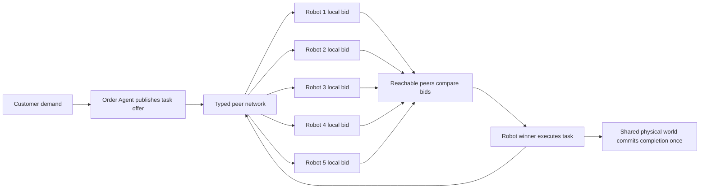
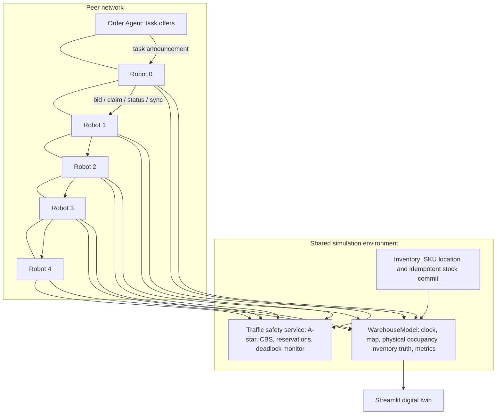

# HiveMine

### An autonomous, decentralised multi-agent warehouse intelligence system

HiveMine is a reproducible warehouse digital twin built for the **Neptune North Challenge at GreatUniHack**. Its five robot agents negotiate fulfillment work over a simulated peer network, navigate a shared 20 × 20 warehouse, and continue using their local knowledge when communication links fail.

The central demonstration is operational: run normal work, partition the robot network, observe local task decisions and progress, then reconnect the robots and inspect reconciliation. This is an in-process communication simulation, not a controller for physical robots.

## Quick start

Windows PowerShell:

```powershell
python -m venv .venv
.\.venv\Scripts\Activate.ps1
python -m pip install -r requirements.txt
streamlit run warehouse_sim/dashboard.py
```

Open http://localhost:8501. To run the command-line simulation:

```powershell
python -m warehouse_sim.main --ticks 200
python -m warehouse_sim.main --ticks 200 --shock
```

Run the test suite:

```powershell
python -m pytest -q
```

## What happens in a tick



The `WarehouseModel` owns the simulation clock, map, physical occupancy, inventory ground truth and outcome metrics. It advances the simulation and renders state; it does not select the robot for ordinary work. Each robot keeps its own position, battery, task memory, bids, claims, event history, neighbours, communication status and decision explanation.

The Order Agent prioritizes orders, resolves SKU locations through Inventory, and publishes task offers. Offers and robot coordination messages use `warehouse_sim/network/`. The Fleet Manager remains for administrative compatibility and existing failure paths, but normal order dispatch does not call its assignment algorithm.

## Decentralised allocation

HiveMine implements a **consensus-inspired, single-task peer auction**. Eligible robots independently score an offer using Manhattan distance, remaining battery, local workload and urgency. Robots broadcast bids to reachable peers. After a one-tick bid window, each robot that has received bids selects the lowest score, with robot ID as a deterministic tie-break, and broadcasts a leased claim.

This is CBAA-style task bidding, not full CBBA: robots do not build and optimize multi-task bundles, and there is no formal convergence guarantee under arbitrary loss or long partitions. A partition can produce conflicting claims because independent groups cannot observe one another. HiveMine records these conflicts and applies a deterministic score/robot-ID rule when claims meet again.

## Simulated network

`NetworkSimulator` uses a graph with a line of robot peers and an Order Agent connection to Robot 0. Messages have IDs, sender/recipient, typed payloads, creation and expiry ticks, path and delivery status. Routes follow current graph links; a broken path drops the message. The seeded simulator supports:

- link disconnection, two-group partitions and single-robot isolation;
- per-message latency, packet loss, message expiry and reconnection;
- task announcements, bids, claims, completions, status and state-sync messages;
- per-robot local histories, duplicate completion protection and reconciliation logs.

When connectivity returns, robots exchange local task, bid and claim state. Completion is idempotent, and stock is decremented at most once per task. Independent groups can temporarily make conflicting claims; the model does not claim perfect global consistency during a partition.

## Dashboard

HiveMine now opens to a simple three-area product experience:

- **Home** — the interactive Plotly 3D warehouse, Start/Pause/Reset controls, speed, a plain-English activity feed, and a guided walkthrough.
- **Explore** — choose one of the five robots to inspect its real task, route, battery, destination and reason for choosing work. Its local messages and task knowledge are tucked into **Technical details**.
- **Experiment** — simulate a network failure, split or isolate robots, disconnect everyone, add delay or packet loss, then restore communication. The 3D links, group membership and progress figures come from the live simulator.

The 3D scene shows actual robot positions, planned paths, destinations, shelf racks, packing and charging stations, obstacles and active/broken peer links. Drag to rotate, scroll to zoom, right-drag to pan, use the camera toggle for a top-down view, or reset the camera from Plotly's toolbar. Robot movement and activity updates follow actual model ticks; the frontend does not animate fake results.

Use **Show me how HiveMine works** for a six-stage, real-simulation walkthrough. The final Experiment settings panel retains the warehouse shocks, observed throughput comparison and JSON/CSV run exports.

## Architecture



The graph in the Network Lab displays robot links; the Order Agent link is a task-source link into Robot 0. The shared traffic safety service still centralizes route reservations and CBS conflict handling so the existing collision-avoidance behavior remains intact. This is a deliberate limitation of the hackathon prototype: task assignment is peer-negotiated, while shared physical safety and inventory accounting remain environmental services.

## Algorithms and safeguards

- A-star for four-directional warehouse routes.
- Conflict-Based Search (CBS) for multi-robot path conflicts and reservations.
- Local distance/battery/workload/urgency bidding with deterministic tie-break.
- Wait-for graph deadlock detection and yielding.
- Finite-state robot control, battery-aware charging and idempotent task completion.
- Seeded message loss and simulation randomness for reproducible scenarios.

## Limitations

- The graph transport is an in-process simulator, not a real network or ZeroMQ deployment.
- Bid agreement is a small CBAA-inspired auction, not complete CBBA and not guaranteed to converge under arbitrary asynchronous loss.
- A task offer is sourced by the Order Agent through Robot 0. A group cut off from that source can complete known work but may not learn new offers until a state exchange reconnects it.
- Traffic reservation/CBS and inventory truth remain shared safety/environment services.
- Reconciliation is deterministic for received claims; concurrent physical execution may already have progressed before a conflict becomes visible.
- Grid movement simplifies acceleration, sensors, turning, payloads, workers and physical safety.

## Project layout

```text
warehouse_sim/
  agents/       customer, order, inventory, robots, fleet, traffic, charging
  algorithms/   A-star, CBS and legacy scoring utilities
  network/      typed messages and deterministic graph transport
  tests/        algorithm, recovery, network and integration tests
  model.py      shared physical world and simulation lifecycle
  dashboard.py  three-area Streamlit experience and controls
  visualization/  Plotly 3D warehouse scene from live model state
  events.py     warehouse and communication disruptions
```

For the judge walkthrough, see [PROJECT_SHOWCASE_GUIDE.md](PROJECT_SHOWCASE_GUIDE.md).
